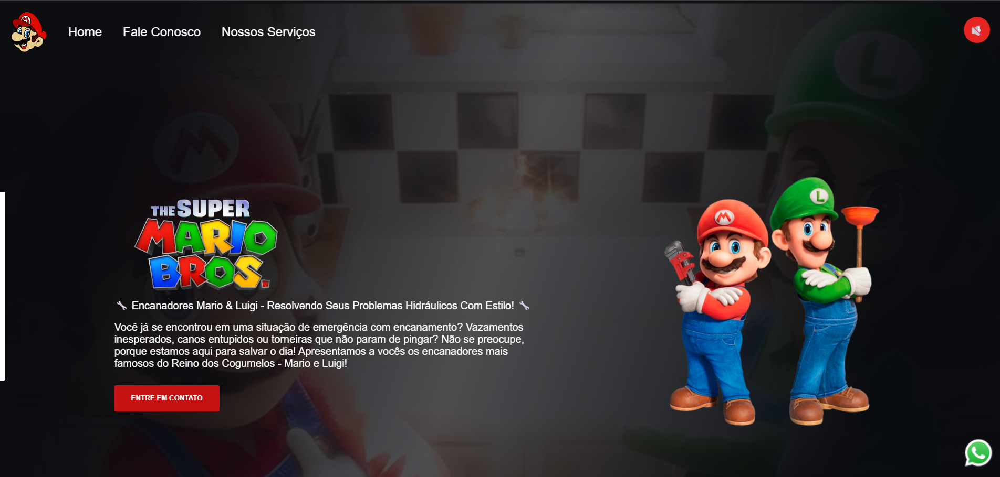

# 🍄 Mario Bros — Encanadores

Site institucional responsivo para uma empresa fictícia de encanadores, inspirado no universo de Super Mario Bros. O projeto reúne apresentação dos serviços, formulário de contato para o cliente descrever seu problema e um botão que toca o tema clássico do Mario.



🔗 **Demo:** <a>mariobrossdevclub.netlify.app</a>

---

## ✨ Funcionalidades

- 📱 **Layout responsivo**: adaptado para desktop, tablet e celular
- 🛠️ **Aba de serviços**: apresentação dos serviços oferecidos
- 📝 **Formulário de contato**: o cliente informa nome, e-mail e o problema que precisa resolver
- 🎵 **Música tema**: botão para tocar e pausar a trilha sonora do Mario

## 🧰 Tecnologias

- HTML
- CSS
- JavaScript

## 📂 Estrutura do projeto

```
mario-bros/
├── assets/
│   ├── img/
│   └── audio/
│       └── mario-theme.mp3
└── style.css
└── script.js
└── index.html
```

## 🚀 Como executar

1. Clone o repositório:
   ```bash
   git clone https://github.com/[seu-usuario]/mario-bros.git
   ```
2. Acesse a pasta do projeto:
   ```bash
   cd mario-bros
   ```
3. Abra o arquivo `index.html` no navegador ou use uma extensão como o **Live Server** (VS Code).

## 📬 Formulário de contato

O formulário coleta os seguintes campos:

| Campo    | Tipo  | Descrição                         |
|----------|-------|-----------------------------------|
| Nome     | texto | Nome do cliente                   |
| E-mail   | email | E-mail para retorno               |
| Problema | texto | Descrição do problema do cliente  |

Todos os campos são obrigatórios e validados antes do envio.

## 🎵 Música tema

O botão de áudio alterna entre **tocar** e **pausar** a música.

## 📱 Responsividade

O layout usa media queries para se ajustar a diferentes tamanhos de tela, mantendo leitura e navegação confortáveis em qualquer dispositivo.

## 👨‍💻 Autor

**Matheus Oliveira**
- LinkedIn: <a>https://www.linkedin.com/in/matheus-oliveira-dias/</a>
- GitHub: [@matheusdiass1](https://github.com/seu-usuario)

---

> ⚠️ Projeto sem fins comerciais, feito para estudo. Mario e Luigi são marcas da Nintendo.
